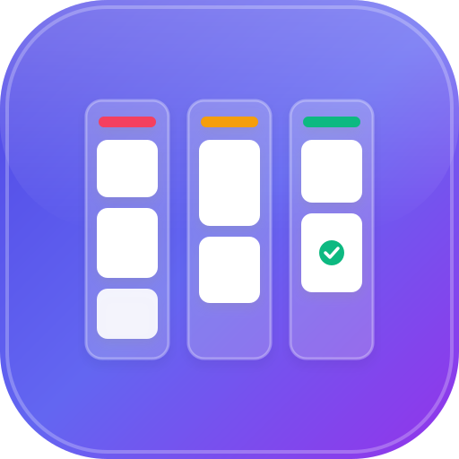

<div align="center">

  

  # FlowBoard ⚡
  ### *Futuristic Glassmorphic Cloud Kanban Web Application*

  <p>
    <a href="https://kanban-web-app-one.vercel.app/auth" target="_blank">
      
    </a>
    
    
    
    
    
  </p>

  <p>
    🔗 <strong>Live Production URL:</strong> <br />
    <a href="https://kanban-web-app-one.vercel.app/auth" target="_blank"><strong>https://kanban-web-app-one.vercel.app/auth</strong></a>
  </p>

</div>

---

## 🌐 Live Production Demo

FlowBoard is deployed and running live on **Vercel**:

👉 **[https://kanban-web-app-one.vercel.app/auth](https://kanban-web-app-one.vercel.app/auth)**

- **Instant Access**: Open the link on any desktop, tablet, or mobile phone.
- **Zero Configuration**: Sign in with an email & password or create an account in 5 seconds.
- **Real-Time Multi-Device Sync**: Any change you make updates across all open tabs and devices instantly.

---

## 🌟 Overview & Key Highlights

FlowBoard elevates modern project workflows with desktop-grade speed, fluid drag-and-drop mechanics, and a deep cyber aesthetic. Engineered with **React 19**, **TypeScript**, and **Material UI v7**, FlowBoard keeps your board seamlessly in sync across all devices via **Google Cloud Firestore**.

### 🚀 Core Superpowers:
1. **☁️ Real-time Cloud Sync (Firestore)**: Sign in once and access your board anywhere. Changes propagate across browser tabs and devices with debounced automatic cloud persistence.
2. **🤖 AI Smart Task Planner (Gemini API + Offline Engine)**: Type any project idea (e.g. *"Launch a SaaS MVP in 14 days"* or *"Prepare for Tech Interviews"*) and the AI engine automatically plans tasks, priorities, deadlines, and multi-step checklists.
3. **🔥 Task Priorities & Smart Due Dates**: Assign `Urgent`, `High`, `Medium`, or `Low` priority badges. Smart deadline indicators calculate relative time (`Today`, `Tomorrow`, `X days overdue`).
4. **✅ Subtasks & Interactive Checklists**: Break complex cards into checklist items with a dynamic progress bar and completion counters.
5. **🏷️ Quick Filters & Multi-Criteria Sorting**: Filter cards instantly with one-click toggles (`High Priority`, `Due Soon`, `Overdue`), tag colors, or sort by `Due Date`, `Priority`, or `A → Z`.
6. **📦 Board Backup & Transfer (JSON / CSV)**: Download full-fidelity offline JSON backups or export CSV spreadsheets to Excel and Notion. Restore or merge backup files anytime with collision prevention.
7. **🔔 Live Task Activity Log & History**: A slide-out notification drawer tracks every move, creation, checklist completion, and edit chronologically with relative timestamps.
8. **🎨 High-Performance Cyber UI**: Cosmic deep dark mode, high-contrast light mode, independent column vertical scrolling, and fluid 1:1 drag-and-drop tracking.
9. **📱 100% Responsive for Web & Mobile**: Handcrafted layout adapting seamlessly from 360px mobile viewports to ultra-wide desktop monitors.

---

## 🛠️ Technology Stack

| Layer | Technologies Used | Description |
| :--- | :--- | :--- |
| **Live Deployment** | **Vercel** | Global edge network hosting with automated CI/CD builds |
| **Frontend Framework** | **React 19**, **React DOM 19** | Modern React with concurrent rendering and optimized component trees |
| **Language & Tooling** | **TypeScript 5.8**, **Vite 7** | Strictly typed codebase with lightning-fast Hot Module Replacement |
| **Design System & UI** | **Material UI (MUI) v7**, **Emotion** | High-performance theming, dark/light color tokens, and custom cyber styling |
| **Typography** | **Plus Jakarta Sans**, **Outfit** | Curated Google Fonts delivering a modern, technical aesthetic |
| **State Management** | **Zustand 5** | Atomic selectors with local storage persistence middleware |
| **Drag & Drop** | **@hello-pangea/dnd** | Smooth, accessible drag-and-drop for cards and workflow columns |
| **Cloud & Backend** | **Firebase 12** (Authentication & Firestore) | User isolation security rules with real-time `onSnapshot` bi-directional live sync |
| **Generative AI** | **Google Gemini API** (Gemini 1.5 Flash) | AI project breakdown engine with built-in zero-config heuristic fallback |
| **Export / Import** | **Native Web Streams & Blobs (RFC 4180)** | Zero-dependency JSON serializer and RFC-compliant CSV parser with UTF-8 BOM |

---

## 🧭 Architecture & Project Structure

```
Kanban Web App/
├── public/
│   ├── logo.svg                         # FlowBoard official brand logo
│   └── vite.svg                         # Secondary vector asset
├── src/
│   ├── components/
│   │   ├── activity/
│   │   │   └── ActivityDrawer.tsx       # Slide-out real-time activity timeline drawer
│   │   ├── board/
│   │   │   ├── Board.tsx                # Main board canvas, DragDropContext & column engine
│   │   │   ├── BoardColumn.tsx          # Droppable column with independent vertical scrollbar
│   │   │   ├── BoardFilterBar.tsx       # Quick filter chips, tag menus & sort controls
│   │   │   └── TaskCard.tsx             # Memoized draggable card, priority badges & progress bar
│   │   ├── layout/
│   │   │   └── AppLayout.tsx            # Responsive glass navigation bar, search & controls
│   │   └── modals/
│   │       ├── AiPlannerModal.tsx       # Gemini AI project generator interface
│   │       ├── ColumnModal.tsx          # Create & edit columns with color swatches
│   │       ├── ConfirmModal.tsx         # Safety dialog for destructive actions
│   │       ├── ExportImportModal.tsx    # JSON/CSV file download, upload & merge manager
│   │       └── TaskModal.tsx            # Comprehensive task, priority & checklist editor
│   ├── context/
│   │   ├── ColorModeContext.tsx         # Dark / Light theme provider with custom MUI tokens
│   │   └── NotificationContext.tsx      # Global toast snackbar notification system
│   ├── hooks/
│   │   ├── useFirestoreSync.ts          # Auth state listener & Cloud Firestore sync trigger
│   │   └── useStore.ts                  # Central Zustand store (tasks, columns, activities)
│   ├── screens/
│   │   ├── BoardScreen.tsx              # Primary Kanban route
│   │   └── AuthScreen/                  # Clean sign-in & register portal
│   ├── services/
│   │   ├── aiPlannerService.ts          # Gemini API integration + offline rule generator
│   │   ├── boardTransferService.ts      # JSON/CSV serializers, RFC parser & file downloaders
│   │   └── firestoreSync.ts             # Bi-directional debounced Firestore database sync
│   ├── firebase.tsx                     # Firebase Client SDK initialization
│   ├── index.css                        # Global fonts, scrollbar styles, CSS resets
│   └── main.tsx                         # React 19 application root
├── firestore.rules                      # Production Firestore security rules
├── package.json                         # Dependencies and build scripts
├── tsconfig.json                        # TypeScript configuration
└── vite.config.ts                       # Vite bundler configuration
```

---

## 🚀 Step-by-Step User Flow & User Guide

### 1. Account Creation & Sign In
- Navigate to **[https://kanban-web-app-one.vercel.app/auth](https://kanban-web-app-one.vercel.app/auth)**.
- Enter your email and password to log in or create a new account.
- **Why?** Each user receives an isolated Firestore document space (`/users/{userId}/kanban/board`) so your board remains private, secure, and accessible from any device.

### 2. Live Cloud Sync Indicator
- In the top navigation bar, check the **Cloud Sync Pill**:
  - 🟢 **`CLOUD SYNCED`**: Board is safely synchronized with Google Cloud Firestore.
  - 🟣 **`SAVING...`**: Actively writing changes to the cloud (debounced by 500ms).
  - 🔴 **`OFFLINE`**: Operating locally using storage fallback. Click the pill anytime to retry syncing.

### 3. Creating & Managing Tasks
- Click **`+ Add a task`** at the bottom of any column:
  - **Title**: Enter your task description.
  - **Priority**: Choose `Urgent`, `High`, `Medium`, or `Low` for clear visual hierarchy.
  - **Due Date**: Select a deadline or click quick shortcuts (`Today`, `Tomorrow`, `In 1 Week`).
  - **Checklist Subtasks**: Break the task into actionable steps.
  - **Tag Colors**: Select one of 8 vibrant color tags.
- Hover over any card to reveal quick **Edit** and **Delete** actions.

### 4. Independent Column Scrolling
- Columns maintain a fixed header and pinned `+ Add a task` button at the bottom.
- When cards exceed the column height, a sleek, styled vertical scrollbar appears inside that column without disrupting the rest of the board.

### 5. Interactive Checklist & Progress Tracking
- Check off subtasks directly inside the task modal or inspect progress from the board.
- The progress bar dynamically updates and turns emerald green upon 100% completion (`X/Y subtasks • 100%`).

### 6. AI Smart Project Planner
- Click the golden **`AI Plan`** button in the header.
- Select a preset idea (*"Master TypeScript"*, *"Launch SaaS MVP"*, *"Tech Interview Prep"*) or type your own custom project prompt.
- Click **`Generate Plan`**:
  - **Zero-Config Engine**: Works immediately without an API key using the built-in smart milestone planner.
  - **Optional Gemini API**: Paste a free Gemini API key to activate live Google Gemini 1.5 Flash generation for any niche prompt.
- Select which tasks to keep, choose your target column, and click **`Add Tasks to Board`**.

### 7. Quick Filters & Sorting
- Use the **Filter Toolbar** located directly above the columns:
  - Click **🔥 High Priority** to isolate Urgent and High tasks.
  - Click **⏰ Due Soon** to see tasks due within the next 3 days.
  - Click **🚨 Overdue** to catch missed deadlines.
  - Filter by specific **Priority** level or **Tag Color**.
  - Sort by **Due Date (Earliest First)**, **Priority (Highest First)**, or **Alphabetical (A → Z)**.
  - Click the **Reset** pill at any time to return to your normal drag-and-drop order.

### 8. Backup, Export & Import (JSON / CSV)
- Click the cyan **`Transfer`** button in the navigation header:
  - **Export JSON**: Download a complete backup of all columns, task orders, checklists, and colors.
  - **Export CSV**: Download an Excel-ready spreadsheet for reporting in Google Sheets or Notion.
  - **Import & Restore**: Drag and drop any `.json` or `.csv` backup file. Choose between:
    - **Merge with Current Board (Safe)**: Keeps your existing board and appends the new tasks.
    - **Replace Current Board**: Performs a clean board restore from the backup file.

### 9. Real-Time Activity Log & History
- Click the purple **🔔 Bell Icon** in the top right to open the **Activity Drawer**.
- Browse chronological records of all recent moves, edits, subtask checks, and column changes.
- Filter by `All`, `Tasks`, `Moves`, `Checklists`, or `Columns`.

---

## ⚡ Local Development Setup

### Prerequisites
- **Node.js**: v18.0 or higher
- **npm** or **pnpm**
- A **Firebase Project** with Cloud Firestore and Authentication enabled (Email/Password provider).

### Installation Steps

1. **Clone the repository:**
   ```bash
   git clone https://github.com/Divakardivak/Kanban-Web-App.git
   cd "Kanban-Web-App"
   ```

2. **Install dependencies:**
   ```bash
   npm install
   ```

3. **Configure Firebase:**
   Ensure `src/firebase.tsx` matches your Firebase project credentials:
   ```ts
   const firebaseConfig = {
     apiKey: "YOUR_API_KEY",
     authDomain: "YOUR_PROJECT_ID.firebaseapp.com",
     projectId: "YOUR_PROJECT_ID",
     storageBucket: "YOUR_PROJECT_ID.firebasestorage.app",
     messagingSenderId: "YOUR_SENDER_ID",
     appId: "YOUR_APP_ID"
   };
   ```

4. **Publish Firestore Security Rules:**
   In your **Firebase Console** ➔ **Firestore Database** ➔ **Rules**:
   ```javascript
   rules_version = '2';
   service cloud.firestore {
     match /databases/{database}/documents {
       match /users/{userId}/{document=**} {
         allow read, write: if request.auth != null && request.auth.uid == userId;
       }
     }
   }
   ```

5. **Start the Development Server:**
   ```bash
   npm run dev
   ```
   Open your browser at **http://localhost:5173**.

6. **Create a Production Build:**
   ```bash
   npm run build
   ```

---

## 📱 Mobile & Responsive Design

FlowBoard is handcrafted to be 100% responsive across all screen sizes:
- **Mobile Phones (< 600px)**:
  - Compact header navigation with icon action buttons.
  - Column widths sized to `84vw` for smooth horizontal swiping between Kanban columns.
  - Independent vertical card scrolling with touch momentum.
- **Tablets & Laptops (600px - 1024px)**:
  - Adaptive search bar width preventing header wrapping.
  - Pinned filter bar with responsive horizontal scroll.
- **Desktop Monitors (1024px+)**:
  - Full board statistics chip, wide search bar, multi-column expanded view.

---

## 📄 License

This project is open-source and licensed under the **MIT License** — feel free to customize, modify, and build upon it!
